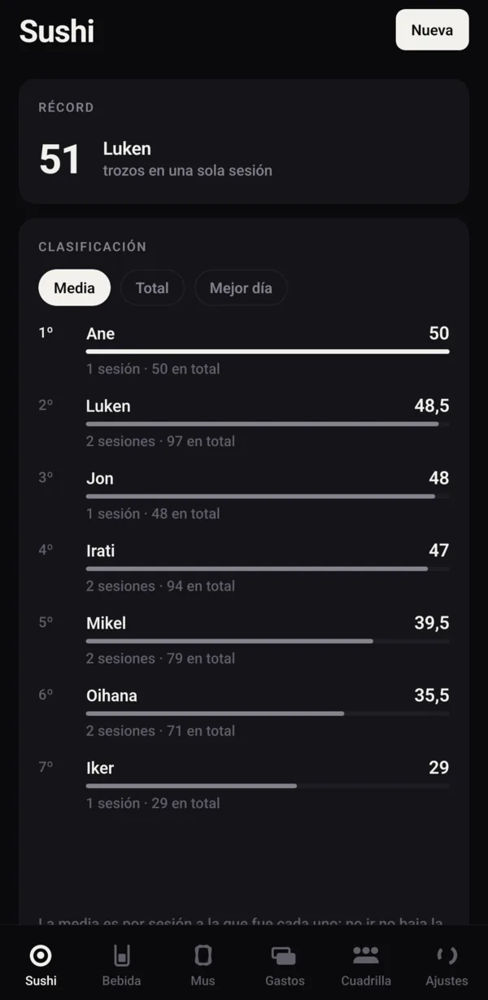

<div align="center">


# Ludok Count

**An Android app for your group of friends: sushi, drinks, mus and shared expenses.**

How many pieces of sushi each one eats at the buffet, who drinks the most each round, the mus
scoreboard and who owes whom, Tricount-style.<br>
One person runs it on their phone and logs for everyone. No accounts, no servers, nobody else has
to install anything.

[](LICENSE)
[](https://www.android.com/)
[](https://docs.expo.dev/versions/v57.0.0/)
[](https://reactnative.dev/)
[](https://www.typescriptlang.org/)
[](https://www.sqlite.org/)

[Features](#what-it-tracks) · [Installation](#installation) · [Backups](#automatic-backup-to-nextcloud) · [Contributing](#contributing) · [License](#license)

<br>



<sub>Sushi ranking</sub>

</div>

---

## Table of Contents

- [The Rule: Never Lose Data](#the-rule-never-lose-data)
- [What It Tracks](#what-it-tracks)
- [Installation](#installation)
- [Building an APK](#building-an-apk)
- [Verifying the Data Layer](#verifying-the-data-layer)
- [Automatic Backup to Nextcloud](#automatic-backup-to-nextcloud)
- [Structure](#structure)
- [Design](#design)
- [Contributing](#contributing)
- [License](#license)

## The Rule: Never Lose Data

Everything else comes second.

- Data lives in `/data/data/com.ludok.count/`. There are no accounts and no servers.
- JSON backups you can export and import at any time.
- **Automatic backup to your own Nextcloud** when you open or close the app on WiFi, one file per
  day.
- A warning on every tab when it's been too long without a backup.
- The data layer is **actually tested**, not just type-checked (see below).

> **What leaves your phone:** nothing, unless you set up the Nextcloud backup. If you do, the
> backup goes straight to your server and nowhere else.

## What It Tracks

| Section | What | Details |
|---|---|---|
| Group | The people | Add, rename and archive them. Someone who stops coming isn't deleted: their history still counts |
| Sushi | Buffet sessions | Each day, who went and how many pieces each one ate. Ranking by average, total and best day; all-time record |
| Drinks | Drinking sessions | A counter per person **and per type** (shot, beer, mixed drink…, editable). A "round for everyone" button |
| Expenses | Expense groups | Who pays what and who it's split between: equally, by shares or by exact amounts. Balances and the fewest payments to settle up |
| Mus | Games between pairs | Live two-sided scoreboard (2 vs 2), with "+1" per pair and an adjustable target (40 by default). Closes itself when a pair reaches the target; history and ranking by games won |

The app's interface is in Spanish.

### Not everyone goes every day

Each session has its own attendees. Being **in** a session is what says someone went; that's why
"went and ate 0" isn't the same as "didn't go", and not going **doesn't lower your average**. The
sushi ranking sorts by average by default for exactly this reason: the total rewards whoever goes
most often, not whoever eats the most.

### Mus, with fixed pairs

Each game pits two fixed pairs against each other (2 vs 2): you pick the four people when creating
it and they can't be changed later. Adding points with "+1" is all you need during the game; to fix
an extra tap, tap the number and type the right one.

The game closes **by itself** as soon as a pair reaches the target (40 by default, adjustable per
game), and from then on it accepts no more points: you have to **reopen** it to continue. If, on
reopening, the leading pair keeps its score as is, the next point scored (by either side) would
close it again immediately; lower their score before carrying on.

### Expenses, to the cent

- All money is stored as **whole cents**, and the split always adds up to **exactly** the amount.
  When it doesn't divide evenly (110 € among 6, for example), the extra cent goes to whoever paid:
  nobody else ever owes too little, but nobody pays more than the others because of rounding
  either.
- Each person's balance is what they paid minus their share. All balances add up to 0.
- **Settling up**: the app works out payments from each person's **net** balance, so if A owes B
  and B owes C, you directly get "A pays C". It first matches exact debts (one payment clears two
  people) and then the biggest debtor pays the biggest creditor. That gives at most n−1 payments.
- Tapping **Pagado** (paid) records a reimbursement: just another expense (one pays, the other
  "consumes"), which is what makes the balance add up without special cases.
- Someone who already appears in a group's expenses can't be removed from it: their debt would be
  left orphaned.

## Installation

### From an APK

Download the APK from the [latest release](https://github.com/iamLudok/Ludok-count/releases/latest)
and install it on your phone (Android will ask you to allow installing apps from that source).

### From source

You need Node 22, JDK 17, the Android SDK with API 36, and `adb`.

```bash
git clone https://github.com/iamLudok/Ludok-count.git
cd Ludok-count
npm install
npm run android      # installs and opens it on a phone connected over adb
npm run typecheck    # types for the app and the verification scripts
npm run verify       # checks the data layer
```

> Gradle needs a **Java 17** toolchain. If it fails with "Cannot find a Java installation matching
> languageVersion=17" while you have a newer JDK, point it to the one Gradle already downloaded:
>
> ```bash
> export JAVA_HOME=~/.gradle/jdks/eclipse_adoptium-17-amd64-linux.2
> ```

## Building an APK

The first time, create your own keystore at the project root:

```bash
keytool -genkeypair -v -keystore release.jks -alias ludok -keyalg RSA -keysize 2048 -validity 10000
```

And a `keystore.properties` next to it:

```properties
storeFile=release.jks
storePassword=your-password
keyAlias=ludok
keyPassword=your-password
```

Both are in `.gitignore`. Then:

```bash
npm run build:apk                    # all architectures
./scripts/build-apk.sh --compartir   # arm64-v8a only, for sharing
# → android/app/build/outputs/apk/release/app-release.apk
```

It has to be a **release** build, not debug: in debug the JavaScript isn't bundled in the APK, it's
loaded from the Metro server, so a debug APK doesn't work without your computer.

Install: `adb install -r app-release.apk`. With `-r` it installs **on top** and keeps the data, as
long as the signature is the same.

> [!WARNING]
> **Guard the keystore with your life.** Android only installs an APK on top of another if both
> are signed with the same key. If it's lost, the only way to install a new version is to
> **uninstall**, and uninstalling **deletes the app's data**. Keep it next to your backups. It's
> the one thing in this project that can't be regenerated.

## Verifying the Data Layer

Data is the part that can't fail, so it's tested by running **the same code that runs on the
phone** against a desktop SQLite:

```bash
npm run verify:data       # backup: round trip of every table, gaps, volume, rejections, password left out
npm run verify:library    # rules: money, splits, settling debts, sushi, drinks, group
npm run verify:migration  # upgrading leaves the same schema and loses nothing
```

Some of the things they check, because they're the ones that would fail silently:

- The backup covers **every** table in the schema (with thirteen, forgetting one when adding it is
  easy).
- Thousands of random splits: the sum is always the total and nobody is more than one cent away
  from their exact share.
- 500 groups with random balances: after the suggested payments, **everyone is at zero** and never
  more than n−1 payments.
- Twenty "+1" taps in a row add up to twenty: the sum happens in SQL, not by reading and writing.
  The mus scoreboard learned this the hard way: a first version with a transaction (read, add,
  write) blew up with `SQLITE_BUSY` when taps arrived at the same time; the good version is a
  single `UPDATE` statement with `CASE`, with no transaction and no prior read.

This works because the logic gets its database from [`src/lib/dbRef.ts`](src/lib/dbRef.ts) instead
of creating it: [`src/lib/db.ts`](src/lib/db.ts) is the **only** file that touches `expo-sqlite`.

It uses **libsql** rather than `better-sqlite3` because the latter is synchronous and doesn't
support async transactions, while `expo-sqlite` does: with libsql the semantics match the real
thing.

## Automatic Backup to Nextcloud

In **Ajustes → Copia automática a Nextcloud**: address, user, password and folder. When you open or
close the app on WiFi it uploads on its own, at most once every 12 hours, with one file per day.

Use a Nextcloud **app password** (Personal settings → Security), not your account password: it can
be revoked on its own. That password is **never included** in exported backups.

It isn't a background task: Android kills them without warning, and you couldn't even tell whether
they work. If the automatic backup hasn't arrived for more than 4 days, a warning shows up.

A home Nextcloud usually runs over `http://`, which Android blocks by default: that's why
`app.json` sets `usesCleartextTraffic`. Use HTTPS or a VPN if your server is reachable from outside.

## Structure

```
app/
  (tabs)/             Sushi · Bebida · Mus · Gastos · Cuadrilla · Ajustes
  sushi/[id].tsx      a buffet session, with the counters
  sushi/edit.tsx      new session / edit date and place
  drinks/…            the same, for drinks
  mus/[id].tsx        a live game: two-sided scoreboard with "+1"
  mus/edit.tsx        new game (pick the pairs) / edit target and note
  group/[id].tsx      an expense group: Expenses | Balances
  group/edit.tsx      new group / name and members
  expense/edit.tsx    new expense / edit, with the three split modes
  person/[id].tsx     someone's page: their numbers across everything
src/
  types.ts            domain model and backup file shape
  lib/                data and rules, nothing native except db.ts, backup.ts, autoBackup.ts
    money.ts          cents, parsing/formatting amounts, splitting without losing cents
    expenses.ts       groups, expenses, balances and minimal payments
    sushi.ts          sessions, counters and stats
    drinks.ts         types, sessions, counters and stats
    mus.ts            games, atomic SQL scoreboard and stats
    people.ts         the group
  hooks/              reactive queries (useLiveQuery)
  ui/                 theme and primitives: no eyeballed colors or sizes outside theme.ts
  components/         pieces with their own logic (welcome, ranking, Nextcloud…)
verify/               data layer tests against a desktop SQLite
```

## Design

"Sala oscura" (dark room), like the other Ludok apps: a **monochrome** interface with no accent
color; hierarchy comes from contrast. There are no posters or photos here, so what stands out are
the **numbers**: each person's big counter and the balances.

Color only appears when it means something: red for deleting, amber for backup warnings, and
**green / orange** for "is owed" / "owes" in the balances, the only place where color is the data.

The counters are designed to be used at the table: the "+" is big and solid, the "−" small and
outlined, and the list **doesn't reorder** while you add (otherwise the card would move under your
finger). Tapping the number lets you correct it by hand.

## Contributing

Pull requests are welcome. See [CONTRIBUTING.md](CONTRIBUTING.md) for the development setup and
conventions. To report a security vulnerability, follow [SECURITY.md](SECURITY.md) instead of
opening a public issue.

## License

Distributed under the **MIT License**: you can use, modify and redistribute it, including for
commercial purposes, as long as you keep the copyright notice. See [LICENSE](LICENSE) for the full
text.

---

<div align="center">

Made by [Luken Iriondo](https://github.com/iamLudok) · If Ludok Count is useful to you, consider giving it a ⭐

🇪🇸 [En castellano](https://iamludok.github.io/ludok-apps-web/apps/count/)

</div>
